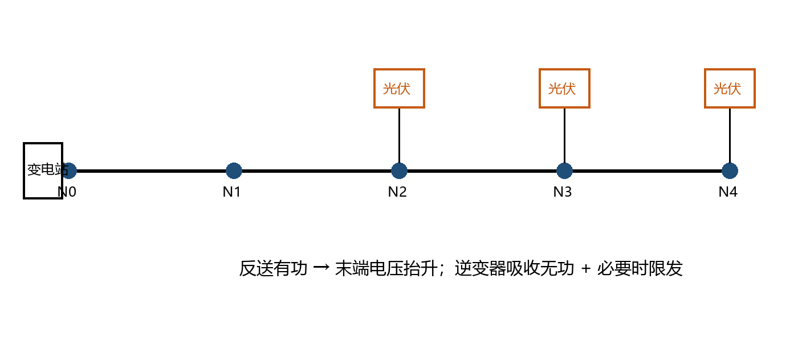

# 1 问题与边界

高比例分布式光伏在午间大发时，馈线潮流由"送"变"受"，末端电压随之抬升。本文研究对象为一条等值单馈线，参数见表 1。

## 1.1 研究边界

- 只讨论稳态电压越限，不讨论暂态过电压；
- 光伏逆变器具备无功调节能力，容量按额定视在功率计；
- 算例采用 **线性化** 电压降落公式，结论需经交流潮流复核。

# 2 电压计算与灵敏度

## 2.1 线性化电压降落

末端电压近似为

$$
V_n \approx V_0 + \frac{R\,(P_{\mathrm{PV}} - P_{\mathrm{cut}}) - X\,Q_{\mathrm{abs}}}{V_0}
$$

式中，$V_0$ 为首端电压，$R$、$X$ 为等值电阻与电抗，$P_{\mathrm{PV}}$ 为光伏净反送有功，$P_{\mathrm{cut}}$ 为限发有功，$Q_{\mathrm{abs}}$ 为逆变器吸收的无功。

## 2.2 电压灵敏度矩阵

对潮流方程线性化得到

$$
\begin{bmatrix} \Delta \boldsymbol{\theta} \\ \Delta \boldsymbol{V} \end{bmatrix}
= \boldsymbol{J}^{-1}
\begin{bmatrix} \Delta \boldsymbol{P} \\ \Delta \boldsymbol{Q} \end{bmatrix},
\qquad
S_{ij} = \frac{\partial V_i}{\partial P_j} = \sum_{k=1}^{N} \left(J^{-1}\right)_{ik}
$$

## 2.3 协调优化模型

以弃光和无功调节代价最小为目标，模型如下：

$$
\begin{aligned}
\min_{Q,\,P_{\mathrm{cut}}} \quad & \sum_{t=1}^{T} \left( c_q \lVert Q_t \rVert_1 + c_p \, P_{\mathrm{cut},t} \right) \\
\text{s.t.} \quad & V_{\min} \le V_{i,t} \le V_{\max}, \quad \forall i, t \\
& Q_t^2 + \left(P_{\mathrm{PV},t} - P_{\mathrm{cut},t}\right)^2 \le S_{\mathrm{inv}}^2, \quad \forall t
\end{aligned}
$$

# 3 算例

: 表1 示例馈线参数

| 参数 | 符号 | 数值 | 单位 |
|:---|:---:|---:|:---:|
| 基准容量 | $S_{\mathrm{base}}$ | 1 | MVA |
| 首端电压 | $V_0$ | 1.020 | pu |
| 等值电阻 | $R$ | 0.060 | pu |
| 等值电抗 | $X$ | 0.040 | pu |
| 电压上限 | $V_{\max}$ | 1.050 | pu |

: 表2 三种治理方案对比

| 方案 | 吸收无功/pu | 限发有功/pu | 末端电压/pu | 说明 |
|---|---|---|---|---|
| 基线 | 0 | 0 | 1.068 | 越限 0.018 pu，需要治理 |
| 无功优先 | 0.300 | 0 | 1.056 | 仍越限，逆变器无功容量已用满，需要进一步采取有功措施 |
| 无功＋限发 | 0.300 | 0.150 | 1.047 | 满足上限，限发电量约占午间出力的 19% |

{width=70%}

# 4 结论

1. 反送有功是末端电压越限的主因，电压灵敏度 $S_{ij}$ 可用于定位最有效的调节点；
2. 无功优先、限发兜底的顺序能在满足电压约束的前提下减少弃光；
3. 线性化算例只证明计算链条可行，工程应用前须开展三相交流潮流与保护配合校验。

# 参考文献

[1] 葛磊蛟, 范延赫, 李小平, 等. 计及日前随机-日内滚动分布式的高比例光伏配电网无功优化方法[J]. 电网技术, 2026. DOI: 10.13335/j.1000-3673.pst.2024.1567.
