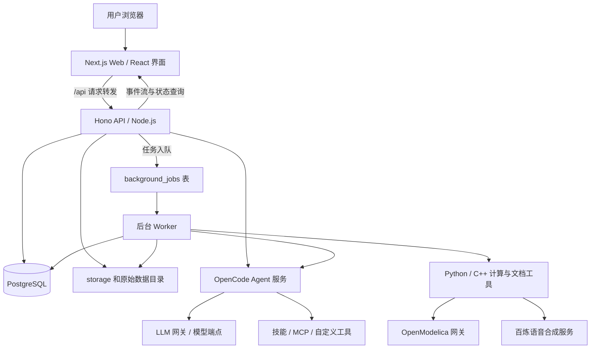
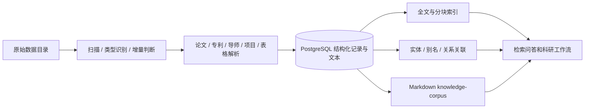

# 能元（AI4ES）系统架构、功能目录与基础技术说明

**仓库：** [liangjiabin0/nengyuan-recovery-merged](https://github.com/liangjiabin0/nengyuan-recovery-merged)

**源码基线：** `fix/recovery-20261002` 分支的 `990a210`，包含恢复修复和 Linux 原生 ESOPT 接入。

**整理日期：** 2026-10-03。本文依据源码及已有验收记录编写；运行路径、端口和模型配置可以随部署变化。

本文用于项目交接、开发定位和部署理解。“基础技术”同时指网页框架、AI 编排方式、数据处理库和实际执行的数值算法。完整入口清单见[页面、API 与技能源码索引](system-source-index.md)。

## 阅读导航

1. [系统整体框架](#1-系统整体框架)
2. [仓库目录职责](#2-仓库目录职责)
3. [主要功能与源码位置](#3-主要功能与源码位置)
4. [方案求解与虚拟仿真的算法基础](#4-方案求解与虚拟仿真的算法基础)
5. [科研文档与 PPT 技能](#5-科研文档与-ppt-技能)
6. [数据、检索与知识图谱](#6-数据检索与知识图谱)
7. [AI 服务、技能和工具的关系](#7-ai-服务技能和工具的关系)
8. [数据库和文件存储](#8-数据库和文件存储)
9. [接口、后台任务和权限](#9-接口后台任务和权限)
10. [运行方式与外部依赖](#10-运行方式与外部依赖)
11. [开发修改定位](#11-开发修改定位)
12. [能力边界与相关文档](#12-能力边界与相关文档)

## 1. 系统整体框架

能元是面向能源科研的 Web 工作台。它把科研资料管理、检索问答、指南与专利编写、研究方案生成、电力计算、仿真及 PPT 处理整合到同一个账号体系中。

生产运行采用 **Web + API + Worker + 独立工具/服务** 的结构：Web 显示界面，API 接收请求和校验权限，Worker 执行队列中的耗时任务，Python/C++ 工具负责求解、预测、语音和文档处理。AI 模型服务通过可配置端点接入。



核心入口：

|层次|主要入口|基础技术与职责|
|---|---|---|
|Web|[src/app](../src/app)、[src/components](../src/components)|Next.js App Router、React、TypeScript；页面、工作台、文件预览和进度显示|
|API|[server/api/index.ts](../server/api/index.ts)、[server/api/routes.ts](../server/api/routes.ts)|Hono、Node.js；复用 `src/app/api/**/route.ts` 中的处理函数|
|业务逻辑|[src/lib](../src/lib)|TypeScript；资料检索、AI 编排、任务状态、求解器调用、成果导出|
|Worker|[server/worker/index.ts](../server/worker/index.ts)|轮询 PostgreSQL 任务队列，执行任务、写入进度、失败重试、取消和心跳|
|Agent|[src/lib/opencode](../src/lib/opencode)、[.opencode](../.opencode)|OpenCode SDK、技能指令、工具调用和 MCP；执行科研工作流|
|计算工具|[tools](../tools)|多个独立 Python 环境、C++ SDK、外部命令；实施数值计算和媒体处理|
|数据层|[src/lib/db](../src/lib/db)、部署产生的 `storage/`|PostgreSQL 保存结构化记录；文件系统保存原始资料和成果|

`package.json` 当前声明 Next.js 16.3.8、React 19.2.7、TypeScript 6.0.3、Hono 4.13.12、Tailwind CSS 3.4 系列；部分依赖采用版本范围，安装版本应以 `package-lock.json` 为准。Python 依赖分别查看工具 requirements 和 [runtime/python-locks](../runtime/python-locks)，不能把所有工具合并成同一个环境。

## 2. 仓库目录职责

```text
仓库根目录/
├─ src/
│  ├─ app/
│  │  ├─ (dashboard)/     首页、Agent、指南、求解、仿真、资料等页面
│  │  ├─ api/             各业务 API Route 模块
│  │  ├─ login/           登录页
│  │  ├─ screen/          展示大屏入口
│  │  ├─ datav-runtime/   DataV 配置与运行时适配
│  │  └─ datav-dc/        DataV 数据接口
│  ├─ components/         React 工作台、图表、导航等界面组件
│  ├─ lib/                业务编排、数据库访问、检索和工具适配
│  └─ proxy.ts            页面/API 的会话入口检查与请求头转发
├─ server/
│  ├─ api/                独立 Hono API 进程
│  └─ worker/             独立后台任务进程
├─ .opencode/
│  ├─ agents/             智能体角色定义
│  ├─ skills/             技能指令、模板、参考资料和执行脚本
│  ├─ tools/              自定义 Agent 工具
│  ├─ plugins/            Agent 插件
│  └─ lib/                Agent 插件/工具辅助实现
├─ tools/                 求解、预测、语音、Office、PDF 等工具
├─ scripts/               启停、安装、构建、迁移、导入和验证入口
├─ public/                浏览器静态资源、DataV、大屏素材与地图数据
├─ runtime/python-locks/  已验收部署的 Python 版本快照
├─ solverCompetition/     独立求解算法研究与实验源码
├─ docs/                  架构、部署、修复和恢复溯源文档
├─ package.json           Node 依赖与 npm 命令
├─ next.config.js         Web 构建、API 转发和附件/超时配置
├─ .env.example           环境配置示例，真实配置不入 Git
└─ README.md              仓库介绍与运行入口
```

`(dashboard)` 是 Next 路由分组，不会出现在 URL 中。例如 `src/app/(dashboard)/grid-guide/page.tsx` 对应 `/grid-guide`。

`storage/`、`数据/`、`.env.local`、`node_modules/`、`.next/`、`dist/`、Python venv 和下载的求解器库属于部署资产，不能因 Git 中没有这些目录就认定业务资料或依赖已经安装。

## 3. 主要功能与源码位置

以下路径均相对仓库根目录。`src/app/api/` 是接口源码位置；生产环境通常由 Hono 进程挂载。

|功能与界面入口|界面组件 / 页面|业务逻辑与 API 文件夹|基础技术|
|---|---|---|---|
|首页 `/`|`src/app/(dashboard)/page.tsx`；`home-dashboard.tsx`、`home-stat-cards.tsx`|`src/lib/dashboard-metrics.ts`、`research-analytics.ts`；`src/app/api/stats/`|React、数据库统计、缓存和图表|
|能元 Agent `/chat`|`src/components/chat-workbench.tsx` 及 `chat-*` 组件|`src/lib/opencode/chat.ts`、`runtime.ts`；`src/lib/chat-*`；`src/app/api/chat/`|OpenCode Agent、可配置 LLM、检索工具、附件分析、实时事件流；对话与成果持久化|
|国网指南设计 `/grid-guide`|`grid-guide-workbench.tsx`、文件树/预览组件|`src/lib/grid-guide/`，入口 `runner.ts`；`src/lib/opencode/grid-guide.ts`；`src/app/api/grid-guides/`|技能工作流、资料检索、结构化文档模型、LLM 生成/修订、Word 导出|
|方案求解 `/scheme-solve`|`scheme-solve-workbench.tsx`、`scheme-flow-canvas.tsx`、`scheme-node-inspector.tsx`|`src/lib/scheme-solve/`，入口 `orchestrator.ts`；`src/lib/opencode/scheme-solve.ts`；`src/app/api/scheme-solve/`|AI 构想与方案生成、分阶段编排、React Flow 流程图、独立数值求解器|
|虚拟仿真 `/virtual-sim`|`virtual-sim-workbench.tsx`、`virtual-sim-viz.tsx`|`src/lib/virtual-sim/pipeline.ts`、`tools.ts`、`visualize.ts`；`src/app/api/virtual-sim/`|仿真任务配置与可视化；复用方案求解会话、队列和各计算引擎|
|PPT 智能配音 `/ppt-voice`|`ppt-voice-workbench.tsx`、`ppt-voice-settings-panel.tsx`|`src/lib/ppt-voice/`，入口 `orchestrator.ts`、`sidecar.ts`；`src/app/api/ppt-voice/`；`tools/ppt-voice/`|Python、python-pptx、百炼 CosyVoice TTS、音频嵌入；Linux 使用 LibreOffice/ffmpeg 等，Windows 可使用 PowerPoint COM|
|学科研究图谱 `/graph`|`knowledge-graph-view.tsx`、`knowledge-graph-canvas.tsx`、`g6-graph-canvas.tsx`|`src/lib/kg/`、`graph-relations.ts`；`src/app/api/graph/`|SQL 实体/关系存储、别名与实体归一、关系关联；Graphology 图算法和 AntV G6 展示|
|科研资料库 `/corpus`|`corpus-browser.tsx`|`src/lib/corpus/browse.ts`、`comments.ts`；`src/app/api/corpus/`、`src/app/api/files/`|PostgreSQL 资料索引、目录与关键词检索、文件预览和批注|
|技能库 `/skills`|`skill-library.tsx`|`src/lib/shared-skills.ts`、`bundled-skills.ts`、`skill-permissions.ts`、`skill-visibility.ts`；`src/app/api/skills/`|Markdown 技能定义、模板/脚本发布、共享技能记录和访问控制|
|自学习记忆 `/self-learning`|`self-learning-memory-page.tsx`|`src/lib/self-learning.ts`、`self-learning-search.ts`；`src/app/api/self-learning/`；`.opencode/tools/save_learning_memory.ts`、`search_learning_memory.ts`|按用户/领域保存操作经验与指令，PostgreSQL 全文检索；通过 Agent 工具读取和写入记忆|
|科研数据表 `/tables`|`src/app/(dashboard)/tables/`、`records-table.tsx`|`src/app/api/records/`、`schema/`；`src/lib/db.ts`、`excel-ingest.ts`|Excel/CSV 解析、结构化科研项目/成果表、分页筛选|
|数据导入 `/settings?tab=data`|`settings-data-panel.tsx`、`import-loading-overlay.tsx`|`src/lib/data-import.ts`、`data-dirs.ts`、`papers.ts`、`mentors.ts`、`patents.ts`、`nkrd-ingest.ts`；`src/app/api/data-import/`|文件扫描、ZIP/CAJ/PDF/表格处理、内容提取、增量索引和图谱关联|
|系统/模型设置 `/settings`、`/models`|`settings-form.tsx`、`subagent-router-panel.tsx`；`src/app/(dashboard)/settings/`、`models/`|`src/lib/config.ts`、`llm.ts`、`subagent-router.ts`、`subagent-router-store.ts`；`src/app/api/settings/`、`models/`|模型端点配置、角色路由、参数/连接探测；配置持久化|
|运行状态监控|`system-runtime-monitor.tsx`|`src/lib/system-runtime.ts`、`runtime-children.ts`；`src/app/api/system/runtime/`|进程/服务探测、任务状态、工具环境检查和 Worker 心跳|
|账号、登录与改密 `/login`、`/account/password`、`/admin/users`|`login-form.tsx`、`change-password-form.tsx`、`admin-users-panel.tsx`、`auth-provider.tsx`|`src/lib/auth/`；`src/app/api/auth/`、`admin/users/`；`src/proxy.ts`|scrypt 加盐密码哈希、随机会话令牌、Cookie 会话、管理员及用户权限|
|科研综述 / 研究复盘|当前 `/chat?tool=research-review`；保留 `research-review-workbench.tsx` 等组件|`src/lib/opencode/research-review.ts`、`research-review-workspace.ts`；`src/lib/research-review/`；`src/app/api/research-review/`|来源资料检索、Agent 技能编排、引用与附件跟踪、Markdown/Word 成果导出|
|专利生成|当前 `/chat?tool=patent`；保留 `patent-workbench.tsx`、阶段/澄清组件|`src/lib/patent-generation/`，入口 `pipeline.ts`、`runner.ts`；`src/lib/opencode/patent.ts`；`src/app/api/patents/`|分阶段 AI 分析、Zod 结构校验、技术交底/权利要求/说明书/附图生成、DOCX 与数学公式处理|
|论文复现与审稿|Agent 工具/技能入口；`paper-repro-execution-chain.tsx` 显示执行链|`src/lib/opencode/chat-repro-*`；`tools/paper-reproduce/overlay/`；`.opencode/skills/paper-reproduce/`、`shared-paper-peer-review/`|Agent 读论文、写/执行代码、运行实验和记录证据；复现依赖具体论文数据/算法环境|
|技术报告自由版 PPT / 两页论文 PPT|Agent 中选择对应共享技能|`.opencode/skills/shared-technical-report-ppt-pipeline/`、`shared-two-slide-paper-ppt-codegen/`；`tools/ppt-native/`|来源分析、提示词与参考模板、PptxGenJS、MathJax、JSZip、可编辑 PPTX 构建；详见第5节|
|AI 图像生成与编辑|Agent 中的图像工具入口|`src/lib/image-generation.ts`、`image-prompt-optimize.ts`；`src/app/api/images/`；`tools/image-generation/`|可配置图像模型 HTTP API、提示词优化、参考图与蒙版请求；需要对应图像端点授权|
|外部学术/互联网检索|Agent 工具及各科研工作流|`src/lib/searxng.ts`；`.opencode/tools/web_search.ts`；`tools/openalex/`、`.opencode/skills/openalex/`|SearXNG 聚合搜索、OpenAlex 学术数据 API；网络与服务配置影响可用性|
|知识包导入/导出|资料 API 和运维 CLI|`src/lib/ragpack/`；`src/app/api/ragpack/`；`scripts/ragpack-cli.ts`|manifest、打包/解包、资料交换与导入任务状态|
|展示大屏 `/screen`|`src/app/screen/`、`command-screen.tsx`、`command-cockpit.tsx`、`datav-china-map.tsx`|`src/lib/datav-screen.ts`、`datav-mentor-geo.ts`；`src/app/datav-runtime/`、`datav-dc/`；`public/datav/`、`public/screen/`|React、DataV 页面/运行时适配、地图与科研统计展示；本地地图缓存与部分外部资源|

上表中没有写出完整前缀的组件均在 `src/components/`。完整 API/页面文件链接见[源码索引](system-source-index.md)。

### 当前入口变化

`/patent` 的页面源码会跳转到 `/chat?tool=patent`；`/research-review` 跳转到 `/chat?tool=research-review`；`/data` 跳转到 `/settings?tab=data`。旧组件和 API 保留不等于当前仍有独立菜单入口。菜单的实际定义以 [dashboard-nav.tsx](../src/components/dashboard-nav.tsx) 为准。

## 4. 方案求解与虚拟仿真的算法基础

“方案求解”负责从构想到方案、模型、求解和结果的编排；“虚拟仿真”提供更直接的计算任务入口。两者复用计算工具，而不是每个页面实现一套独立算法。

|计算能力|TypeScript 调用入口|底层目录 / 关键入口|数学与软件基础|依赖/边界|
|---|---|---|---|---|
|通用 LP/MIP、DCOPF|`src/lib/scheme-solve/esopt.ts`、`esopt-mps.ts`、`model-json.ts`|`tools/esopt/esopt_bridge/esopt_agent/service.py`、`native_backend.py`、`highspy_backend.py`；`tools/esopt/native/esopt_native.cpp`|C++ ESOPT SDK 调用 HiGHS；Python CLI/MCP 桥接；电网采用 pg/va/支路弧潮流的线性 DCOPF 模型|原生试用限300变量/约束；大规模自动模式用 highspy 并标注后端；MPS/LP 文件直接用 HiGHS；二次/非线性接口尚未暴露|
|多能系统/微电网规划 MGPlan|`mgplan.ts`、`mgplan-runner.ts`、`mgplan-case.ts`、`mgplan-results.ts`|`tools/mgplan/mgplan_agent/cli.py`；`tools/mgplan/scripts/openTEPES*.py`；`tools/mgplan/scripts/opt/`|openTEPES 风格规划/运行模型；当前改编代码使用 PyOptInterface 与 Gurobi，配合 pandas/NumPy 和投资/运行 CSV|需要合法完整 Gurobi 授权、具体业务输入和足够计算资源；不能因原工程名为 openTEPES 就把当前实现写成纯 Pyomo|
|交流最优潮流与主配微协同 TDMG|`tdmg.ts`、`tdmg-runner.ts`、`tdmg-case.ts`、`tdmg-results.ts`|`tools/tdmg-acopf-dispatch/scripts/tdmg_opf.py`、`resource_models.py`|PYPOWER `runopf` / `rundcopf`，NumPy/SciPy；交流/直流潮流、资源约束和子系统协同编排|交流问题通常是非线性局部求解；收敛/成功状态不能等同全局最优证明。需要独立 TDMG 环境|
|电力优化调度 Dispatch|`dispatch.ts`、`dispatch-runner.ts`、`dispatch-case.ts`|`tools/power-dispatch/dispatch_agent/cli.py`；`tools/power-dispatch/src/power_dispatch_skill/` 下的 orchestrator、registry、backends|RunSpec / ResultBundle 规范；pandapower AC/DC OPF；自定义 Pyomo backend；可配置 HiGHS 等求解器|`reference_dry_run` 仅联调；不同后端适用不同模型，不应把干跑数据当成数值求解|
|南网理论线损 NWXS|`loss.ts`、`loss-runner.ts`、`loss-outputs.ts`|`tools/nwxs-loss/`|power-grid-model 潮流/状态估计，NetworkX 拓扑，pandas/NumPy 数据计算；导线与变压器损耗、时刻与日汇总|需要网络拓扑、设备与量测数据；部分标准结果表可能为空，不等于算法生成了这些表的实测记录|
|光伏/风电/负荷/电量预测|`forecast.ts`、`forecast-runner.ts`|`tools/pv-wind-load-forecast/forecast_agent/` 下的 `pv.py`、`wind.py`、`load.py`、`energy.py`|Keras/TensorFlow LSTM、GRU、CNN、双向循环网络等；scikit-learn 的 Ridge/SVR 路径；数据窗口化、训练/预测与评估|依赖实际权重、训练数据、特征与参数。代码包含统计学习回退，必须查看返回模型名/警告；论文精度需另行复现验证|
|Modelica 动态仿真|`modelica.ts`、`modelica-runner.ts`|`tools/openmodelica-gateway/app/main.py`、`services/openmodelica.py`、`services/runner.py`；`examples/BatterySOC.mo`|Modelica 方程建模，OpenModelica 编译/求解，OMPython 控制；FastAPI/uvicorn 提供网关|需要 OpenModelica 运行时、Modelica 库及网关配置；不是仅安装 Python 包就能完成仿真|

本表的 TypeScript 文件除特别说明外均位于 `src/lib/scheme-solve/`。每个工具通常提供 CLI/Agent 桥接，Node 通过子进程或网关调用，并读取 JSON、CSV、图片和模型成果。

### ESOPT、MGPlan 和独立 C++ 规划项目的区别

- `tools/esopt/`：已接入系统的通用线性/整数/DCOPF 桥接。Linux SDK 下载、校验与编译见 [install-linux.sh](../tools/esopt/native/install-linux.sh)。
- `tools/mgplan/`：当前 MGPlan 主路径是 Python 改编规划引擎 + PyOptInterface + Gurobi。安装通用 ESOPT SDK不会自动改变这条主路径。
- `tools/ses-iesp-esopt/`：另一个 ESOPT C++ API + Gurobi 的 openTEPES 风格规划项目，有 `case1` 至 `case6` 数据和对应 C++ 模块。可通过相关技能/独立入口使用，但不是此次通用 Linux ESOPT 接入所替换的 MGPlan 默认引擎。
- `solverCompetition/`：求解算法研究、cuPDLPx/C++ 等实验资源，未发现其作为当前 Web 标准计算主路径的统一入口；不应整目录当成在线系统的必装运行时。

ESOPT 完整许可证与 Gurobi 完整许可证分别管理，任何一种都不能替代另一种。原生 SDK 的试用/完整授权边界见 [ESOPT 接入验收](esopt-integration-20261002.md)。

## 5. 科研文档与 PPT 技能

|能力|定义/模板位置|生成技术与职责|
|---|---|---|
|国网指南|`.opencode/skills/sgcc-tech-guide/`、`shared-sgcc-tech-guide/`；`src/lib/grid-guide/`|资料分析、技能指令、结构化指南生成/修订，`export.ts` 使用 `docx` 等导出 Word|
|专利|`.opencode/skills/patent-*/`；`src/lib/patent-generation/`|技能拆分交底、策略、权利要求、说明书、审查与附图；Zod 校验中间 JSON；`docx-math.ts`、`mtef.ts` 处理公式；导出代码组装 Word 成果|
|科研综述|`.opencode/skills/writing-source-grounded-research-reviews/`；`src/lib/opencode/research-review.ts`、`src/lib/research-review/`|基于来源的资料整理、引用跟踪、Markdown 和 Word 导出|
|论文同行评审|`.opencode/skills/shared-paper-peer-review/`|Agent 按技能指令审读、检查证据并执行必要复现；依赖具体论文材料|
|技术报告自由版 PPT|`.opencode/skills/shared-technical-report-ppt-pipeline/`|来源分析、全局/逐页提示词、参考模板与构建脚本；模板资产由该技能目录提供|
|两页论文 PPT|`.opencode/skills/shared-two-slide-paper-ppt-codegen/`|真实论文参考样例、两页结构、方法/结果提炼、可编辑 PPT 构建和公式修订|
|通用 PPT 构建|`tools/ppt-native/build.mjs`、`math-svg.mjs`、`revise-formulas.mjs`；`tools/pptx/`|PptxGenJS 生成幻灯片，MathJax 渲染公式，JSZip 修改 OOXML；修复版同时保留可编辑公式与兼容显示方案|
|Word / Excel / PDF 工具|`tools/office-docs/`、`docx/`、`xlsx/`、`pdf/`、`markitdown/`|python-docx、openpyxl、pandas、ReportLab、pypdf/pdfplumber、MarkItDown/Pandoc 等；分别承担读取、转换和导出|
|图表与配图|`tools/chart-discovery/`、`tools/image-generation/`、`src/lib/image-generation.ts`|图表/图像技能与生成 API；最终所用端点、算法或图表脚本由任务决定|

这些技能目录包含“指令、参考资料、模板、脚本”，并非每个目录都是独立 Web 服务。模板控制版式，LLM 控制内容提炼，构建器负责生成实际文件，渲染器负责预览/验收。

PPT 制作和 PPT 配音是两条可组合的工作流：制作阶段生成 `.pptx`，配音阶段读取已有 PPT 的备注，调用 TTS，嵌入音频并导出视频。百炼 Key 用于配音服务；图像模型端点和普通文本模型端点需要各自正确配置。

## 6. 数据、检索与知识图谱

### 6.1 导入流水线



总编排入口是 [data-import.ts](../src/lib/data-import.ts)。具体分工：

|数据类型 / 操作|源码位置|技术|
|---|---|---|
|目录、子目录和导入状态|`src/lib/config.ts`、`data-dirs.ts`、`import-state.ts`、`fast-import.ts`|配置解析、文件系统扫描、进度记录和导入选项|
|论文/书籍/白皮书与 CAJ|`src/lib/papers.ts`、`paper-metadata.ts`、`paper-body.ts`、`paper-segment.ts`；`tools/caj2pdf-fresh/`|转换、元数据和正文提取、分段与索引|
|PDF 正文与 OCR|`src/lib/pdf2md.ts`；`tools/pdf2md/`|PyMuPDF、RapidOCR/ONNX Runtime 等；文本提取/OCR 能力依赖输入文件性质|
|导师资料|`src/lib/mentors.ts`、`mentor-retrieval.ts`|导师 ZIP/文件解析、字段归一与结构化检索|
|专利语料|`src/lib/patents.ts`、`patent-text.ts`|Markdown/文件文本、专利字段和索引|
|项目、经费、成果表格|`src/lib/excel-ingest.ts`、`nkrd-ingest.ts`、`nkrd-markdown.ts`、`fund-markdown.ts`|SheetJS `xlsx`、CSV 解析、项目与成果关系整理|
|附件文本与分块|`src/lib/chat-attachments.ts`、`attachments/`、`document-read.ts`|文件类型解析、附件记录、分块与安全预览|
|知识语料导出|`src/lib/corpus/export.ts`、`schema.ts`；`scripts/export-knowledge-corpus.ts`|从数据库导出 Markdown 和 manifest，供 Agent 查阅|

### 6.2 检索技术

核心检索在 `src/lib/search-index.ts`、`fts-index.ts`、`retrieval-core.ts`、`vertical-search.ts` 和各类 `*-retrieval.ts`。数据库 schema 使用 PostgreSQL `tsvector`、GIN 索引、`pg_trgm`，配合标题匹配、文本规范化、分块检索和不同实体类型的检索逻辑。

当前核心实现主要是 **数据库全文/关键词检索 + 文本与实体关联 + LLM 组织答案**。现有核心 schema/全文路径并不要求独立向量数据库；不能仅因文档中出现 RAG 就推定已经使用向量 embedding 或完成全库向量化。

### 6.3 图谱技术

`src/lib/kg/canonicalize.ts`、`entity-resolve.ts`、`rebuild-aliases.ts`、`merge.ts`、`cross-link.ts` 负责名称规范化、别名、重复候选及关联；`graph-engine.ts` 和 `graph-relations.ts` 负责关系查询/计算。数据库存储实体、边、别名、提及和合并候选；前端通过 G6 展示图谱。图谱关联质量仍受原始记录完整性、姓名重名和机构归一影响。

## 7. AI 服务、技能和工具的关系

|概念|位置|实际含义|
|---|---|---|
|模型端点|`src/lib/config.ts`、`llm.ts`、`model-ids.ts`|配置的文本/图像模型地址、角色、参数与调用协议；OpenAI SDK 是客户端协议层，不代表只能用 OpenAI 云模型|
|LLM 网关|`scripts/llm-gateway.mjs`、`src/lib/openai-anthropic-compat.ts`、`gateway-thought-stream.ts`|协议适配、调用转发及思考/事件流处理；具体走哪个模型取决于运行配置|
|OpenCode 服务|`scripts/linux/opencode-sidecar.sh` / `scripts/opencode-sidecar.ps1`；`src/lib/opencode/runtime.ts`|独立 Agent 执行服务，管理会话、工具调用、问题交互、重试和执行轨迹|
|智能体定义|`.opencode/agents/`、`src/lib/subagent-router.ts`、`subagent-router-store.ts`|角色指令和任务路由；子智能体的模型/技能可由系统设置控制|
|技能定义|`.opencode/skills/`；`src/lib/bundled-skills.ts`、`shared-skills.ts`|工作方法、资料、模板和执行脚本；运行时还可能 materialize 到工作区/共享技能目录|
|自定义工具|`.opencode/tools/`|目前包括网页搜索、共享技能和学习记忆的读写入口|
|MCP / CLI 计算接口|`scripts/*-mcp.*`、各 `tools/*/*_agent/`|把真实计算和文件操作提供给 Agent；MCP 是工具调用协议，不是优化求解算法|

常见工作流是：用户输入 → 选择模型/智能体/技能 → 检索资料或解析附件 → Agent 编写计划/模型/脚本 → 调用真实工具 → 保存成果与执行轨迹 → 前端展示。

已有自学习记忆功能保存可检索经验并在后续任务中提供上下文。这不等于在线训练或修改大模型权重；模型训练/微调需要另一个专门流程。

## 8. 数据库和文件存储

数据库入口是 [db.ts](../src/lib/db.ts) 与 [db/pg-database.ts](../src/lib/db/pg-database.ts)，表结构见 [db/schema.ts](../src/lib/db/schema.ts)。当前主运行数据库为 PostgreSQL；`better-sqlite3` 和旧 `rag.sqlite` 相关配置/脚本主要用于历史兼容与迁移，不能据此将当前系统描述成 SQLite 主数据库。

|业务域|代表性表|
|---|---|
|原始资料与结构化科研数据|`source_files`、`raw_records`、`projects`、`outputs`、`paper_documents`、`paper_chunks`、`mentor_profiles`|
|检索与图谱|`search_records`、`entities`、`edges`、`entity_aliases`、`entity_mentions`、`merge_candidates`|
|账号与聊天|`users`、`auth_sessions`、`chat_conversations`、`chat_messages`、`chat_attachments`、`chat_attachment_chunks`|
|聊天运行与发送队列|`chat_send_queue`、`chat_conversation_runs`、`chat_live_events`|
|技能与记忆|`shared_skills`、`self_learning_memories`|
|专利|`patent_projects`、`patent_sources`、`patent_artifacts`、`patent_generation_runs`、`patent_generation_events`|
|指南|`grid_guide_projects`、`grid_guide_messages`|
|方案/仿真|`scheme_sessions`、`scheme_ideas`、`scheme_stages`、`scheme_events`|
|配音|`ppt_voice_projects`、`ppt_voice_slides`、`ppt_voice_events`、`ppt_voice_messages`|
|后台任务与资料批注|`background_jobs`、`corpus_file_comments`|

文件存储通常包括：

- `数据/` 或 `DATA_ROOT_DIR` 指定的目录：原始论文、专利、导师、表格等资料。
- `storage/settings.json`：系统持久化设置；`storage/ppt-voice-settings.json`：配音配置。可能含私密配置，不能把文件内容作为公开仓库文档。
- `storage/chat-workspaces/`：聊天任务的工作文件、脚本和成果。
- `storage/knowledge-corpus/`：导出的 Markdown 知识语料。
- 指南、方案、配音的独立工作区：具体名称由各模块 `workspace.ts` 及 constants 定义，成果文件与数据库记录共同组成完整项目。
- 工具案例、权重、venv 与 SDK：位于 `tools/` 的部署目录或外部指定路径，部分不入 Git。

备份时需要同时备份 **数据库、业务文件、私密配置及必要运行资产**。只保留 Git 源码不能恢复已有项目、附件或模型权重。现有服务器路径与备份约定见[部署文档](recovery-deployment.md)。

## 9. 接口、后台任务和权限

### 9.1 API 组织

`src/app/api/<业务>/route.ts` 和嵌套 Route 文件导出 GET/POST/PATCH 等处理函数。生产模式的 [server/api/routes.ts](../server/api/routes.ts) 用 Hono 挂载这些函数，适配动态参数，并另外定义健康检查和任务查询接口。

[next.config.js](../next.config.js) 在 `AI4ES_SPLIT=1` 时将 `/api/:path*` 转发至 `AI4ES_API_URL`。API 业务修改要检查 Route 源码与 Hono 注册；不能只新增一个 Route 文件就假定生产拆分模式已挂载。

源码基线包含 **107 个 API Route 文件、20 个 page.tsx 文件、38 个仓库内 SKILL.md 定义**。这些数字是源码条目数，不代表107种业务功能或所有技能均通过验收；明细见[源码索引](system-source-index.md)。

### 9.2 后台任务

任务实现位于 `src/lib/jobs/queue.ts`、`handlers.ts`、`types.ts`。API 根据运行模式选择入队或直接执行；Worker 轮询 `background_jobs`，以事务和带状态条件的更新认领任务，记录重试次数、锁定时间、进度与结果。

已定义的主要任务类型：`data-import`、`excel-ingest`、`graph-rebuild`、`reindex`、`patent-run`、`grid-guide-task`、`scheme-research`、`ppt-voice-build`、`mgplan-solve`、`tdmg-solve`、`dispatch-run`、`loss-calc`、`modelica-sim`、`forecast-run`。具体映射以 [handlers.ts](../src/lib/jobs/handlers.ts) 为准。

前端通过对应业务事件接口、状态查询和实时流显示进度；`storage/worker-heartbeat.json` 供监控判断 Worker 状态。

### 9.3 账号和权限

`src/lib/auth/password.ts` 使用 Node `crypto.scryptSync`、随机 salt 与时序安全比较；`session.ts` 管理随机会话令牌及数据库会话。`request.ts` 提供 `requireUser`、`requireAdmin` 等后端权限检查。

`src/proxy.ts` 为页面/API 提供入口会话检查，React `AuthProvider` 和 `AdminGate` 控制界面显示。后端检查仍必须保留，不能用前端是否显示按钮替代权限控制。修复版已经禁用仅凭 localhost/Host 头自动授予管理员身份的旧行为；旧注释如与实现冲突，应以当前代码为准。

## 10. 运行方式与外部依赖

|进程/服务|常见端口或运行方式|源码/配置入口|作用|
|---|---|---|---|
|Web|3000|`npm run build`、`next start`；`next.config.js`|浏览器入口|
|API|4000，默认绑定127.0.0.1|`server/api/index.ts`；`API_HOST`、`API_PORT`|业务 API|
|Worker|不提供独立浏览器端口|`server/worker/index.ts`|耗时任务|
|PostgreSQL|通常5432|`DATABASE_URL`；`src/lib/db/`|主数据库|
|OpenCode|由 sidecar 设置/状态决定|`scripts/linux/opencode-sidecar.sh`；Windows同名PS1|Agent 执行服务|
|LLM 网关与模型服务|配置决定|`scripts/llm-gateway.mjs`；模型设置|文本/图像推理与协议适配|
|SearXNG|配置决定|`src/lib/searxng.ts`|网络检索|
|OpenModelica 网关|配置决定|`tools/openmodelica-gateway/`|Modelica 编译和仿真服务|
|Python/C++ 工具|按需启动子进程|`tools/` 与 `src/lib/scheme-solve/compute-sidecar.ts`|求解、预测、语音与文件转换|

启动与构建入口：

- Linux：`scripts/linux/intranet-start.sh prod`，配合 systemd 用户服务；当前恢复服务器可使用 `systemctl --user stop ai4es.service` 停止托管服务。
- Windows：`scripts/intranet-start.ps1`、`intranet-stop.ps1` 等入口；本机工具位置与 Linux 不同。
- 构建：`scripts/build-next.mjs` 构建 Web；`scripts/bundle-server.mjs` 生成 `dist/runtime/` 中的 API、Worker 和数据库检查运行文件。
- 安装/迁移：`scripts/install-portable-runtime.ps1`、`scripts/migrate-sqlite-to-pg.ts`、`scripts/restore-runtime-assets.py`，以及各工具安装入口。迁移与资产恢复的具体限制看部署文档。

主要外部依赖与配置类别：

|能力|需要的内容|
|---|---|
|数据库与登录|PostgreSQL、`DATABASE_URL`；首次管理员创建配置及持久化账号|
|AI 文本/Agent|OpenCode 服务、正确的模型 base URL/model/key；可接本地兼容服务或云端|
|AI 图像|独立图像端点、模型名称、API 授权；文本 Key 不自动等同图像权限|
|PPT 配音|百炼/DashScope Key、工作空间、TTS base URL、模型/音色；环境变量包括 `DASHSCOPE_API_KEY`、`BAILIAN_WORKSPACE_ID`、`BAILIAN_BASE_URL`|
|PPT/文档渲染|LibreOffice、ffmpeg、PDF 渲染工具或 Windows PowerPoint；中文字体也影响输出|
|大规模 Gurobi 规划|合法有效的完整 Gurobi 许可证及兼容的 Python/SDK；`MGPLAN_PYTHON` 等工具路径|
|大型原生 ESOPT|完整 ESOPT 许可证、`LICENSE_LOCATION`；原生安装路径可用 `ESOPT_NATIVE_HOME`|
|深度学习预测|TensorFlow/Keras、合适的数据、权重与硬件；各模型的输入形状和特征需匹配|
|Modelica|OpenModelica、Modelica 库、网关及对应 Python 依赖|
|学术检索/地图|OpenAlex 等服务配置、SearXNG；部分规划地图需要 Mapbox token|

外网访问使用的 FRP/Tailscale、服务器 SSH 和 systemd 账号属于部署基础设施，管理密码和云端账号不在应用源码中。真实 Key、账号密码和许可证内容不应放入本说明、README 或 Git。

## 11. 开发修改定位

|想修改的内容|优先查阅的位置|
|---|---|
|菜单名称/显示入口|`src/components/dashboard-nav.tsx`|
|某个页面布局|`src/app/(dashboard)/<功能>/page.tsx` 与 `src/components/<功能>-workbench.tsx`|
|API 请求参数/响应/权限|`src/app/api/<功能>/`，同时核对 `server/api/routes.ts`|
|科研任务步骤、状态和重试|对应 `src/lib/<功能>/runner.ts`、`pipeline.ts` 或 `orchestrator.ts`；通用队列看 `src/lib/jobs/`|
|模型角色/推理参数/路由|`src/lib/config.ts`、`llm.ts`、`subagent-router.ts`；`src/lib/opencode/runtime.ts` 与网关脚本|
|生成内容方法和模板|对应 `.opencode/skills/<技能>/`；结构化校验/导出规则还需查看 `src/lib/<功能>/`|
|数值模型、约束或计算算法|对应 `tools/<工具>/`；参数与输入转换看 `src/lib/scheme-solve/*-case.ts`、`*-runner.ts`|
|检索结果与资料关联|`search-index.ts`、`fts-index.ts`、`*-retrieval.ts`、`src/lib/kg/`|
|数据库字段|`src/lib/db/schema.ts` 及 `pg-database.ts` 中的升级逻辑；核对相关 store、API 和界面类型|
|部署启动/端口/构建|`scripts/linux/`、对应PS1、`next.config.js`、`scripts/build-next.mjs`、`bundle-server.mjs`|

一次功能修改通常同时涉及 **页面组件 → API → 业务编排 → 工具/数据库** 中的多个位置。数据库记录、工作区文件与 Agent 技能指令需要保持一致。

## 12. 能力边界与相关文档

源码存在、依赖安装、接口能够启动、完整业务正确运行是不同层次。本文是源码与技术地图；已有验收的具体范围以修复报告为准。

当前已验证原生 ESOPT 的线性/整数/DCOPF/PSLP 路径和新百炼配音的 PPTX/MP4 链路；大型 MGPlan 仍需要完整 Gurobi 授权，预测精度与复杂科研长流程不能仅凭健康检查判定。原生 ESOPT 未授权规模限制与未接入的二次/非线性能力仍然有效。

部分旧 README/SKILL 中的启动命令、Windows二进制描述或建模技术名可能沿用历史版本，例如 MGPlan 的旧主函数说明。维护时先沿当前调用链检查真实代码，再查看同日期验收记录，不要直接把旧说明当作现行部署契约。

相关文档：

- [页面、API 与技能源码索引](system-source-index.md)：所有页面、107个API Route模块、仓库技能及工具目录。
- [恢复版部署说明](recovery-deployment.md)：当前启动、配置、数据路径和恢复限制。
- [逐项修复与验收报告](recovery-repair-report-20261002.md)：已修复问题和实际验收范围。
- [ESOPT 接入说明与验收](esopt-integration-20261002.md)：原生接口、试用限制与测试结果。
- [ESOPT 工具说明](../tools/esopt/README.md)：安装、CLI、后端选择和许可证配置。
- [历史恢复记录](codex恢复记录/)与[原项目文档](原项目/)：用于来源追溯，部分内容不适用于当前修复版。
